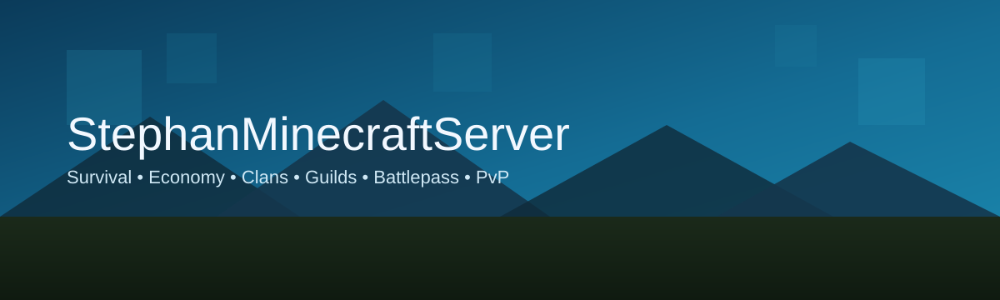

# StephanMinecraftServer 🧱✨


Survival server with a long-term progression focus: economy, jobs, clans, guilds, battlepass, and permanent PvP. ⚔️

## 🌍 Overview
StephanMinecraftServer is a survival server project with a clean progression loop and a strong social layer.
The goal is to build a stable core first, then add MMO-like systems and events.

## ⚔️ Core Features (planned)
- 🛡️ Clans / Guilds
- 🏆 Leaderboards
- 🎟️ Battlepass
- 🧰 Jobs
- 🎤 Voice chat
- 🗺️ New map on wipe
- ⚔️ PvP enabled 24/7
- 🧪 The End opens 2 weeks after wipe

## 💰 Economy
We use **EssentialsX Economy** as the main currency.
Players can earn, trade, and transfer coins in-game. 💸
Donations will be added later through a safe integration (placeholder for now).

## 🧩 Tech
- 🧱 Server: Spigot 1.21.11
- 💳 Economy: EssentialsX + Vault
- 🧪 Scripting: Skript (custom commands and glue logic)

## 🛠️ Build (server files)
We use a small configurator to download the server jar and plugins.

1) Open `build/server-files.json`
2) Fill the `url` fields (and optional `sha256`)
3) Run:

```bash
.\build server-files
```

Notes:
- In PowerShell you must run from the repo folder.
- Use `-Force` to re-download existing files.
- Spigot jars are usually built locally (BuildTools). If you already have a jar, set its URL to your own download link.

### Auto-fill from local JARs
If you already have the `.jar` files locally, you can auto-generate the list:

```bash
.\build scan server-files
```

### Auto-fill URLs from the internet
You can also resolve download URLs from GitHub Releases, Modrinth, or Hangar.
Add a `source` block to an entry, then run:

```bash
.\build resolve server-files
```

Example entries:

```json
{
  "name": "GSit",
  "output": "plugins/GSit.jar",
  "url": "",
  "sha256": "",
  "source": {
    "type": "hangar",
    "slug": "GSit",
    "platform": "PAPER",
    "channel": "Release",
    "gameVersion": "1.21.11"
  }
}
```

```json
{
  "name": "SomePlugin",
  "output": "plugins/SomePlugin.jar",
  "url": "",
  "sha256": "",
  "source": {
    "type": "github",
    "owner": "OWNER",
    "repo": "REPO",
    "assetRegex": ".*\\.jar$"
  }
}
```

```json
{
  "name": "ModrinthPlugin",
  "output": "plugins/ModrinthPlugin.jar",
  "url": "",
  "sha256": "",
  "source": {
    "type": "modrinth",
    "project": "PROJECT_ID_OR_SLUG",
    "loaders": ["paper"],
    "gameVersions": ["1.21.11"],
    "primary": true
  }
}
```

## 🗺️ Roadmap
1. ✅ Stable core (performance, anti-cheat, base configs)
2. 💰 Economy loop (jobs, shops, coin sinks)
3. 🧑‍🤝‍🧑 Social systems (clans/guilds, global chat)
4. 🎯 Progress systems (battlepass, cosmetics, pets)
5. 🧙 MMO expansion (quests, roles, deeper progression)

## 🚧 Status
Early development / configuration phase. 🚀

---

If you want to contribute or suggest features, open an issue or pull request.
